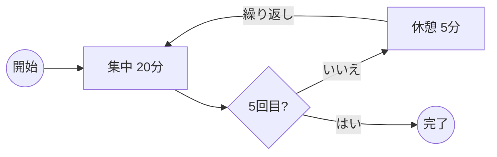

# 集中アラーム (FocusAlarm)

Windows「クロック」アプリのフォーカスセッションと同じ考え方で集中時間を区切り、各セッションの終わりを**アラームのように**知らせるタイマーです。

> [!NOTE]
> Windows PowerShell 5.1 と WPF だけで動きます。**インストールもコード署名も不要**です。

---

## 特徴

| 機能 | 内容 |
| --- | --- |
| ⏱️ 合計時間の自動分割 | 休憩込みの合計時間（15〜240分）を、1回あたり約21分の集中セッションと休憩に自動で振り分けます |
| ☕ 休憩 | 休憩の有無と長さ（5分 / 10分 / 15分）を選べます |
| ▶️ 自動で次へ | 次のセッションを自動で始めるかどうかを選べます |
| 🔔 アラーム | 最前面のウィンドウを表示し、音をループ再生します |
| 🔊 音と音量 | Windows 標準のアラーム音・着信音から選べます。選ぶと数秒試聴できます |
| 😴 スヌーズ | 1分 / 5分 / 10分 |
| 💬 デスクトップ通知 | アラームと一緒にトースト通知も出せます |
| 🔒 多重起動の防止 | すでに起動しているときは、メッセージを表示して終了します |

> [!TIP]
> 右側の設定パネルにある **「鳴らして確認する」** を押すと、選んだ音と通知をその場で試せます。

### 合計時間の分け方

たとえば **合計120分・休憩5分** の場合、**集中20分 × 5回** と **休憩5分 × 4回** に分割されます。



<details>
<summary>分割の計算方法（クリックで開く）</summary>

1. セッション数 $n$ = 合計時間 ÷（21 + 休憩時間）を四捨五入（最低1回）
2. 集中時間の合計 = 合計時間 −（$n$ − 1）× 休憩時間
3. 集中時間の合計を $n$ 回に均等に分け、端数は前のセッションから1分ずつ足す

> [!NOTE]
> 合計時間が **30分以下** のとき、または休憩をオフにしたときは分割されません（休憩オフのときは、集中セッションが休憩なしで続きます）。

</details>

---

## 動作環境

- [x] Windows 10 / 11
- [x] Windows PowerShell 5.1（Windows に標準で入っています）

---

## 使い方

1. このリポジトリをダウンロードし、好きな場所に置きます。
2. `FocusAlarm.cmd` をダブルクリックすると起動します。
3. 必要なら `CreateShortcut.cmd` を実行します。スタートメニューとデスクトップに「集中アラーム」のショートカットができます。

> [!IMPORTANT]
> ZIP でダウンロードした場合、Windows がファイルをブロックしていることがあります。`CreateShortcut.cmd` を実行すると、フォルダ内のファイルのブロックもまとめて解除されます。

ショートカットを削除するときは、PowerShell で次を実行します。

```powershell
.\CreateShortcut.ps1 -Remove
```

### アラームが鳴ったとき

| ボタン | 動作 |
| --- | --- |
| **止める** / **休憩を始める** / **集中を始める** | 音を止めて、次のフェーズに進みます |
| **スヌーズ** | 音を止めて、設定した時間のあとにもう一度鳴らします |

> [!WARNING]
> 「次のセッションを自動で始める」が**オフ**のときは、ボタンを押すまで次のセッションは始まりません。席を外している間はタイマーが止まったままになります。

---

## ファイル構成

```text
FocusAlarm/
├── FocusAlarm.ps1        アプリ本体
├── FocusAlarm.cmd        本体をウィンドウなしで起動するランチャー
├── CreateShortcut.ps1    ショートカットの作成（-Remove で削除）
├── CreateShortcut.cmd    CreateShortcut.ps1 をダブルクリックで実行するランチャー
├── README.md
└── LICENSE
```

---

## 設定とログ

| 種類 | 場所 |
| --- | --- |
| 設定 | `%APPDATA%\FocusAlarm\settings2.json` |
| エラーログ | `%APPDATA%\FocusAlarm\error.log` |

> [!NOTE]
> 設定は画面で変更した時点で自動保存されます。うまく動かないときは、まずエラーログを確認してください。

---

## 開発メモ

> [!CAUTION]
> `FocusAlarm.ps1` には日本語が含まれるため、必ず **UTF-8（BOM 付き）** で保存してください。BOM がないと、Windows PowerShell 5.1 で文字化けして起動しません。

---

## ライセンス

[MIT No Attribution（MIT-0）](LICENSE) です。

> [!TIP]
> 改変・再配布・商用利用はすべて自由です。**著作権表示を残す必要もありません。**
